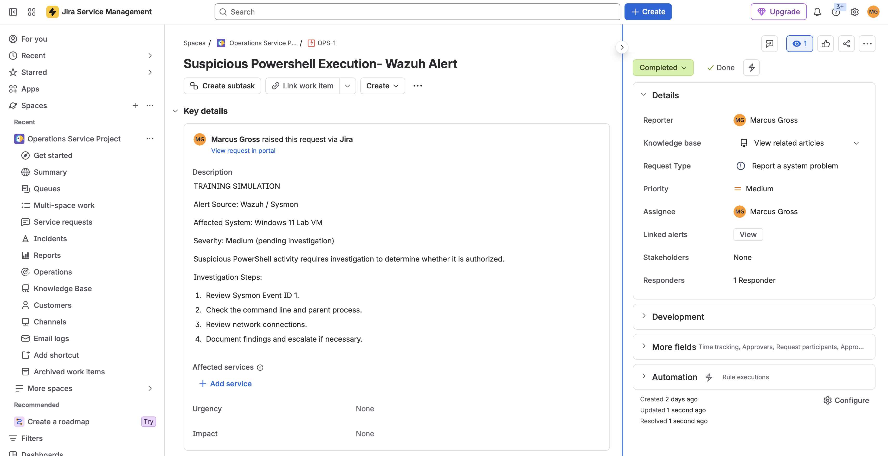

# SOC Investigation: Suspicious PowerShell Execution

## Investigation Overview
- Case ID: OPS-1
- Environment: Personal SOC Homelab
- Tools: Wazuh, Sysmon, Windows 11, Jira Service Management
- Severity: Medium
- Status: Completed
- Disposition: Likely Benign

## Alert Summary
Investigated suspicious PowerShell execution detected through Sysmon and analyzed in Wazuh SIEM.

## Investigation Steps
1. Opened Wazuh Threat Hunting.
2. Filtered events for endpoint SOC-WIN11.
3. Reviewed Sysmon Event ID 1 (Process Creation).
4. Examined the PowerShell command line.
5. Identified wazuh-agent.exe as the parent process.
6. Correlated activity with Wazuh security configuration assessments.
7. Documented findings in Jira ticket OPS-1.

## Evidence Collected
- Endpoint: SOC-WIN11
- Event ID: 1
- Process: PowerShell.exe
- Parent Process: wazuh-agent.exe
- Activity: Windows security policy inspection
- Related Finding: CIS account lockout duration check failed

## Investigation Findings
The PowerShell execution was consistent with legitimate Wazuh security assessment activity.

The failed account lockout configuration check was identified as a separate security-hardening issue.

## Resolution
Classified the investigated activity as likely benign and completed the Jira incident investigation workflow.

## Skills Demonstrated
- SIEM Alert Triage
- Sysmon Log Analysis
- PowerShell Investigation
- Parent-Child Process Analysis
- Incident Documentation
- Jira Ticket Management
- Security Configuration Assessment

## Environment
This investigation was performed in a personal cybersecurity homelab.
## Jira Investigation Evidence

