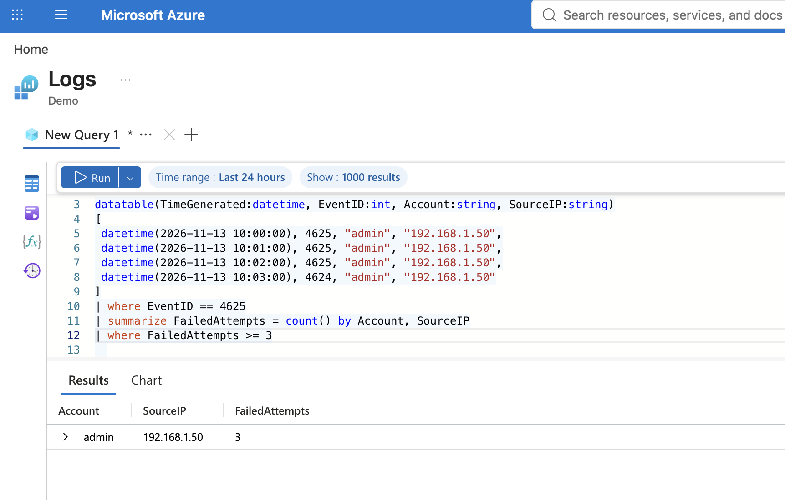
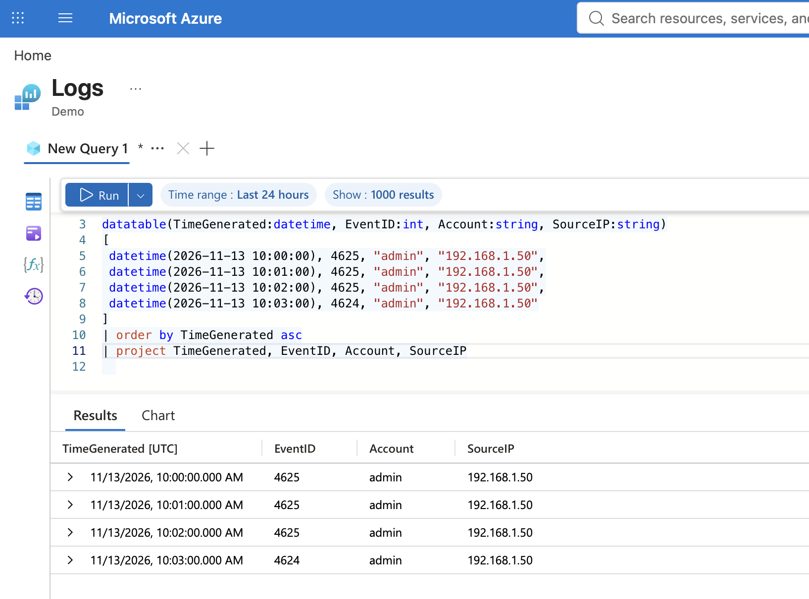

# Lab 7: KQL Authentication Investigation

## Objective
Investigate suspicious Windows authentication activity using Kusto Query Language (KQL) in the Microsoft Azure Logs demo environment.

## Tools Used
- Microsoft Azure Logs (Demo)
- Kusto Query Language (KQL)
- Simulated Windows Security Events

## Investigation Scenario
A simulated administrator account experienced three failed login attempts followed by one successful login from the same source IP address.

## Evidence Collected
- **Account:** admin
- **Source IP:** 192.168.1.50
- **Failed Logins:** 3 (Event ID 4625)
- **Successful Logins:** 1 (Event ID 4624)
- **Date:** November 13, 2026

## Investigation Screenshots

### Failed Login Detection

### Authentication Timeline

## Investigation Process
1. Created simulated Windows authentication events using KQL `datatable`.
2. Developed a query to identify accounts with three or more failed login attempts.
3. Correlated failed and successful authentication events.
4. Reviewed the chronological sequence of login activity.

## Findings
Three consecutive failed authentication attempts occurred at 10:00 AM, 10:01 AM, and 10:02 AM, followed by a successful login at 10:03 AM.

This pattern could indicate password guessing followed by successful authentication. However, the events were simulated, and no actual account compromise was established.

## SOC Analyst Recommendations
- Verify whether the login activity was authorized.
- Review additional authentication logs and endpoint telemetry.
- Investigate the source IP address.
- Consider account lockout policies and multifactor authentication.

## Conclusion
Successfully developed and executed KQL queries to identify repeated authentication failures and investigate a subsequent successful login. This exercise demonstrates foundational SOC skills in log analysis, detection engineering, and authentication-event correlation.
