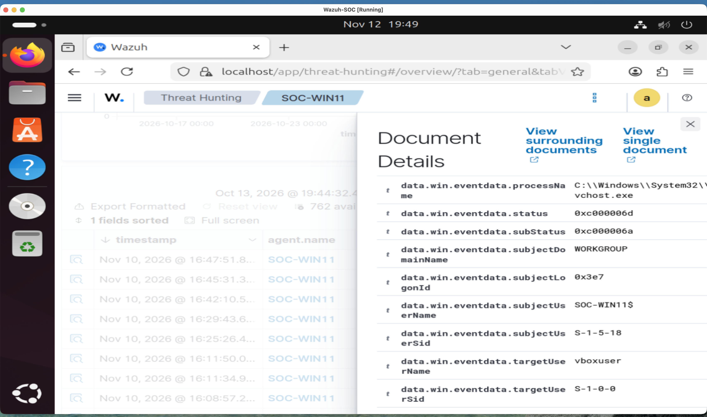
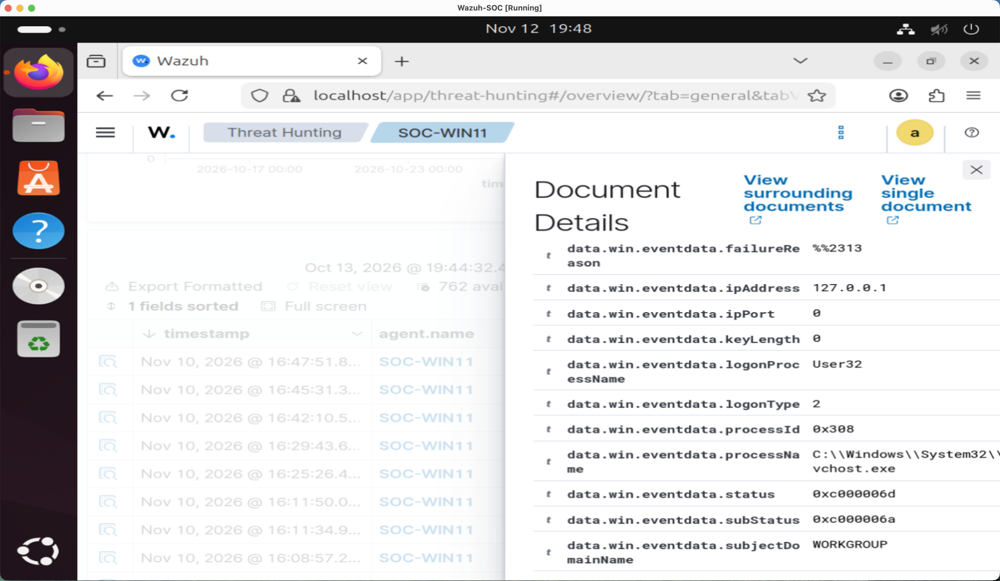

# Lab 5: MITRE ATT&CK Threat Hunting

## Investigation Overview

**Environment:** Personal SOC Analyst Homelab  
**Endpoint:** SOC-WIN11 (Wazuh Agent 003)  
**Tools:** Wazuh SIEM, Sysmon, Windows Event Viewer, MITRE ATT&CK  
**Investigation Date:** November 12, 2026  
**Status:** Completed  
**Classification:** No Confirmed Malicious Activity

## 1. Investigation Objective

Conduct hypothesis-driven threat hunting using Windows security telemetry collected by Wazuh.

Investigate two MITRE ATT&CK techniques:

- T1059.001 - Command and Scripting Interpreter: PowerShell
- T1110 - Brute Force

Determine whether observed behavior is consistent with legitimate system activity or potentially malicious actions.

## 2. Threat Hunt 1: PowerShell Execution

### MITRE ATT&CK Mapping

- Tactic: Execution
- Technique: T1059 - Command and Scripting Interpreter
- Sub-technique: T1059.001 - PowerShell

### Hunting Hypothesis

Unexpected PowerShell execution, particularly with suspicious command-line arguments or unusual parent processes, may indicate malicious activity.

### Investigation Steps

1. Opened Wazuh Threat Hunting.
2. Selected Windows endpoint SOC-WIN11.
3. Examined Sysmon Event ID 1 process creation telemetry.
4. Identified PowerShell execution events.
5. Reviewed command-line arguments and process relationships.
6. Correlated the PowerShell activity with its parent process.

### Evidence Collected

- Process: powershell.exe
- Parent Process: wazuh-agent.exe
- Parent Path: C:\Program Files (x86)\ossec-agent\wazuh-agent.exe
- Integrity Level: System
- Command Activity: Windows account lockout policy inspection

The observed PowerShell command examined Windows security policy settings using a temporary configuration export.

### PowerShell Investigation Screenshot

### Findings

The PowerShell activity was consistent with legitimate Wazuh security configuration assessment.

Although PowerShell execution can be associated with MITRE ATT&CK T1059.001, this event did not establish malicious execution.

**Classification: Likely Benign**

## 3. Threat Hunt 2: Failed Authentication Activity

### MITRE ATT&CK Mapping

- Tactic: Credential Access
- Technique: T1110 - Brute Force

### Hunting Hypothesis

Repeated failed authentication attempts may indicate password guessing or brute-force activity.

### Investigation Steps

1. Opened Wazuh Threat Hunting.
2. Selected endpoint SOC-WIN11.
3. Filtered Windows Security Event ID 4625.
4. Identified 15 matching failed-login alerts.
5. Examined the targeted account, source address, and logon type.
6. Correlated findings with a previous Windows authentication investigation.

### Evidence Collected

- Event ID: 4625
- Target Account: vboxuser
- Source IP: 127.0.0.1
- Logon Type: 2 (Interactive)
- Logon Process: User32
- Caller Process: svchost.exe
- Status: 0xC000006D
- Substatus: 0xC000006A (Incorrect Password)

The source address was the local loopback address, and the examined event represented an interactive authentication failure.

### Failed Login Account Evidence

### Failed Login Source Evidence

### Correlation With Previous Investigation

During Lab 4, Windows Event Viewer displayed 22 failed authentication events, while Wazuh returned 15 matching alerts within the selected search criteria.

A successful interactive authentication for vboxuser was also observed approximately five seconds after an examined failed login.

The examined local account policy had no configured account lockout threshold.

### Findings

The observed activity was consistent with local authentication problems, including incorrect passwords.

The collected evidence did not establish systematic password guessing by an attacker.

Mapping the investigation to T1110 represents a hunting hypothesis, not confirmation of a brute-force attack.

**Classification: Likely Benign / Brute Force Not Confirmed**

## 4. Investigation Limitations

- Not every failed authentication event was individually investigated.
- No external attacker source was identified in the examined events.
- The available telemetry did not establish the intent of the authentication attempts.
- PowerShell activity was consistent with legitimate security assessment.
- No confirmed malicious activity was identified.

## 5. Recommended Security Improvements

1. Continue monitoring PowerShell process creation using Sysmon.
2. Review unusual PowerShell command lines and parent processes.
3. Monitor repeated Windows authentication failures.
4. Investigate unexpected source addresses and logon types.
5. Review Windows account lockout and password policies.
6. Consider creating detection rules for suspicious authentication patterns.
7. Correlate multiple event sources before escalating potential incidents.

These recommendations were documented but not implemented during this threat hunt.

## 6. Skills Demonstrated

- MITRE ATT&CK Framework Mapping
- Hypothesis-Driven Threat Hunting
- Wazuh SIEM Investigation
- Sysmon Process Creation Analysis
- PowerShell Command-Line Analysis
- Parent-Child Process Investigation
- Windows Security Event Analysis
- Authentication Failure Investigation
- Alert Correlation
- False-Positive Analysis
- Evidence Collection
- Technical Incident Documentation

## 7. Conclusion

Conducted two threat hunts using Windows telemetry collected by Wazuh.

The first investigation examined PowerShell execution and mapped the observed behavior to MITRE ATT&CK T1059.001.

The second investigated repeated failed authentication events using MITRE ATT&CK T1110 as a hunting hypothesis.

Both investigations demonstrated the importance of analyzing process context, account activity, and supporting telemetry before classifying an event as malicious.

No malicious activity was confirmed.

This exercise was completed in a personal cybersecurity homelab for educational and portfolio purposes.
