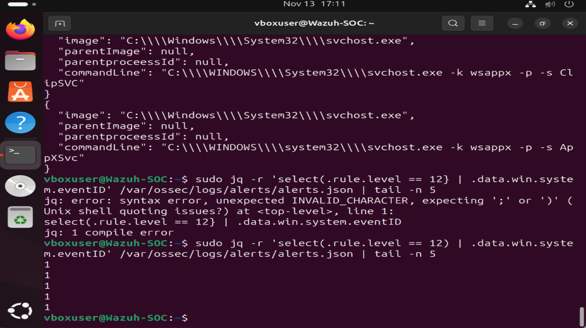

# Lab 8: SOC Shift Simulation

## Investigation Overview

This lab simulates a Tier 1 SOC Analyst shift involving security alert monitoring, investigation, classification, and incident documentation.

The objective was to review Wazuh security alerts, investigate suspicious process activity, and determine whether the observed events required escalation.

## Lab Environment

- Wazuh SIEM
- Windows 11 endpoint (SOC-WIN11)
- Sysmon
- Ubuntu Linux
- Oracle VirtualBox

## Investigation Scenario

During a simulated SOC shift, multiple high-severity alerts were identified in Wazuh.

The alerts involved Windows Service Host (svchost.exe) process creation activity.

## Initial Alert Details

- Alert Severity: Level 12
- Endpoint: SOC-WIN11
- Process: C:\Windows\System32\svchost.exe
- Event ID: 1 (Sysmon Process Creation)
- Detection: Sysmon - Suspicious Process - svchost.exe

## Investigation Steps

1. Verified that Wazuh Manager was running.
2. Confirmed the Windows endpoint agent was active.
3. Reviewed security alerts collected by Wazuh.
4. Identified multiple Level 12 svchost.exe alerts.
5. Examined process paths and command-line arguments.
6. Confirmed Sysmon Event ID 1.
7. Attempted to review parent process information.

## Investigation Findings

The observed command lines referenced Windows services, including:

- FrameServer
- CameraMonitor
- WaaSMedicSvc
- ClipSVC
- AppXSvc

The process paths were consistent with the legitimate Windows System32 directory.

Parent process information was unavailable in the reviewed alert records.

No confirmed malicious behavior was identified from the available evidence.

## Alert Classification

**Classification:** Likely False Positive

**Reason:** The detection rule flagged svchost.exe activity associated with normal Windows services.

**Confidence:** Moderate

**Disposition:** Further validation recommended before final closure.

## SOC Analyst Recommendations

- Verify process signatures and parent-child relationships.
- Review additional Sysmon and Windows security logs.
- Tune overly broad detection rules to reduce false positives.
- Monitor for unusual svchost.exe execution paths or command-line arguments.
- Escalate if additional indicators of compromise are discovered.

## Investigation Evidence

The screenshot below documents the Sysmon Event ID verification performed during the investigation.

**Endpoint:** SOC-WIN11

**Alert:** High-severity svchost.exe process creation detection

**Actions Taken:** Reviewed alert severity, process paths, command-line arguments, and Sysmon Event IDs.

**Current Assessment:** Likely benign Windows service activity.

**Outstanding Action:** Validate parent process information and digital signatures before closing the alerts.

**Escalation:** Not indicated by the available evidence; reassess if new suspicious indicators appear.

## Skills Demonstrated

- SOC alert monitoring and triage
- SIEM log analysis
- Sysmon event investigation
- False-positive identification
- Security event correlation
- Incident documentation
- SOC shift handoff reporting

## Conclusion

Successfully performed a simulated Tier 1 SOC Analyst investigation using Wazuh and Sysmon.

The exercise demonstrated the ability to review high-severity alerts, analyze endpoint activity, assess potential false positives, and document findings for the next SOC shift.
