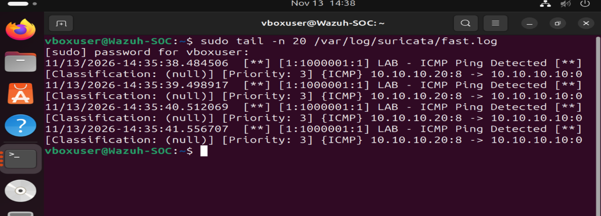

# Lab 6: Suricata IDS — ICMP Detection Investigation

## Investigation Overview

This lab demonstrates the deployment and testing of Suricata, an open-source Network Intrusion Detection System (NIDS), in a virtual cybersecurity homelab.

The objective was to configure Suricata to monitor network traffic, create a custom ICMP detection rule, generate controlled test traffic, and verify that the resulting alerts were recorded successfully.

## Lab Environment

- Suricata IDS 7.0.3
- Ubuntu Linux (Wazuh-SOC VM)
- Windows 11 endpoint
- Oracle VirtualBox
- Host-only lab network: 10.10.10.0/24

- ## Custom Suricata Detection Rule

A custom Suricata signature was created to detect ICMP echo requests sent from the Windows 11 endpoint to the Ubuntu monitoring server.

The rule was stored in:

`/etc/suricata/rules/local.rules`

The signature used the following configuration:

- Action: alert
- Protocol: ICMP
- Source IP: 10.10.10.20 (Windows 11)
- Destination IP: 10.10.10.10 (Ubuntu)
- ICMP Type: 8 (Echo Request)
- Signature ID: 1000001
- Revision: 1

The rule was validated using Suricata's configuration testing functionality before live traffic monitoring.

## Detection Testing and Results

After validating the custom detection rule, Suricata was started on the `enp0s9` network interface.

Controlled ICMP traffic was generated from the Windows 11 endpoint (10.10.10.20) to the Ubuntu monitoring server (10.10.10.10).

### Investigation Findings

- Suricata successfully detected the ICMP echo requests.
- Four alerts were recorded in `/var/log/suricata/fast.log`.
- Alert message: LAB - ICMP Ping Detected
- Signature ID: 1000001
- Alert priority: 3
- Source IP: 10.10.10.20
- Destination IP: 10.10.10.10
- ICMP type: 8 (Echo Request)

### Analysis

The alerts confirmed that the custom Suricata rule successfully identified the controlled ICMP traffic.

The activity was authorized lab testing, not evidence of a malicious attack.

## Detection Evidence

The screenshot below shows Suricata generating alerts after detecting ICMP echo requests from the Windows 11 endpoint.

