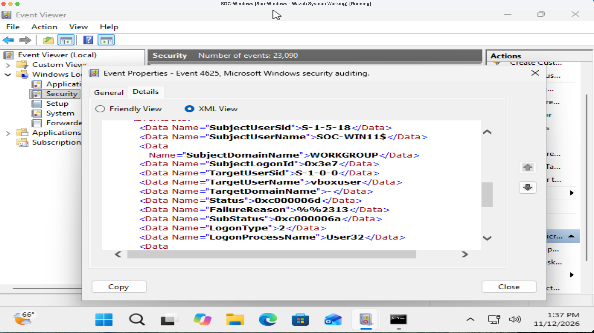
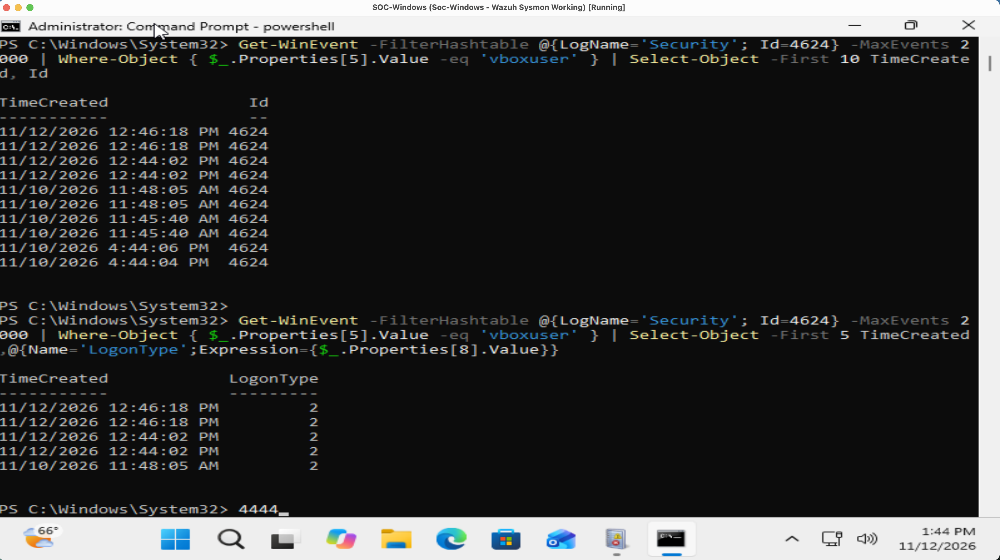
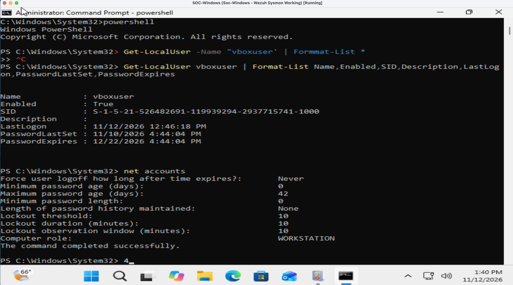

# Windows Incident Response: Failed Login Investigation

## Investigation Overview

**Lab:** 4 - Windows Incident Response  
**Environment:** Windows 11 Virtual Machine (SOC-WIN11)  
**Tools:** Windows Event Viewer, PowerShell, Windows Security Logs  
**Investigation Date:** November 12, 2026  
**Status:** Investigation Completed  
**Classification:** Likely Benign Authentication Activity / Security Hardening Required

## 1. Investigation Objective

Investigate repeated Windows authentication failures, determine whether the activity indicates unauthorized access, and identify security configuration weaknesses.

The investigation focused on Windows Security Event IDs 4625, 4624, and 4740.

## 2. Initial Alert Investigation

Windows Event Viewer identified 22 failed authentication events (Event ID 4625).

### Failed Login Evidence

- Event ID: 4625
- Target account: vboxuser
- Computer: SOC-WIN11
- Logon Type: 2 (Interactive)
- Source Network Address: 127.0.0.1
- Logon Process: User32
- Caller Process: svchost.exe
- Status: 0xC000006D
- Substatus: 0xC000006A

The substatus indicates an incorrect password.

Multiple failed authentication events were observed across different dates.

### Failed Login Screenshot

## 3. Successful Login Correlation

Windows Security Event ID 4624 was analyzed to identify successful authentication activity involving the same account.

### Findings

- Event ID: 4624
- Account: vboxuser
- Logon Type: 2 (Interactive)
- Failed Login: November 12, 2026, 12:46:13 PM
- Successful Login: November 12, 2026, 12:46:18 PM
- Time Difference: 5 seconds

A successful interactive login occurred five seconds after the failed authentication attempt.

This pattern is consistent with an incorrect password followed by a successful login. However, the available evidence does not establish who performed the authentication.

### Successful Login Evidence

## 4. Windows Account Investigation

The local Windows account was examined using Command Prompt and PowerShell.

Commands used:

`net user vboxuser`

`Get-LocalUser vboxuser | Format-List Name,Enabled,SID,Description,LastLogon,PasswordLastSet,PasswordExpires`

### Findings

- Account: vboxuser
- Account Enabled: Yes
- Local Group Membership: Administrators and Users
- Last Logon: November 12, 2026, 12:46:18 PM
- Account Description: Blank

The account has local administrator privileges, which increases the potential impact of unauthorized access.

No unauthorized access was confirmed.

## 5. Account Lockout Policy Investigation

Windows Security Event ID 4740 was examined for account lockout events.

No Event ID 4740 records were found in the examined Security log.

The following command was executed:

`net accounts`

### Security Policy Findings

| Setting | Observed Value |
|---|---|
| Account Lockout Threshold | None |
| Account Lockout Duration | 10 minutes |
| Lockout Observation Window | 10 minutes |
| Minimum Password Length | 0 |
| Password History | 0 |

These settings identify security-hardening opportunities.

The absence of an account lockout threshold allows repeated incorrect-password attempts without triggering an automatic account lockout under the configured local policy.

### Account Policy Evidence

## 6. Investigation Assessment

**Classification: Likely Benign Authentication Activity / Security Hardening Required**

### Supporting Evidence

- 22 failed authentication events were identified.
- Examined failed login events targeted vboxuser.
- Logon Type 2 indicated local interactive authentication.
- An examined failure recorded the loopback address 127.0.0.1.
- A successful vboxuser login occurred five seconds after a failed attempt.
- No account lockout events were found.
- Local account lockout protections were not configured.

### Investigation Limitations

Not every failed authentication event was individually attributed to a specific source or process.

The available evidence does not definitively establish the identity or intent of the person initiating the login attempts.

No malicious activity was confirmed.

## 7. Recommended Remediation

1. Configure an appropriate account lockout threshold.
2. Review minimum password length requirements.
3. Configure password history to discourage password reuse.
4. Review whether vboxuser requires administrator privileges.
5. Monitor Windows Event IDs 4625, 4624, and 4740.
6. Investigate unusual login patterns or unexpected remote authentication sources.

These recommendations were documented but not implemented during the investigation.

## 8. Skills Demonstrated

- Windows Event Viewer analysis
- Windows Security Event ID investigation
- Failed and successful authentication correlation
- PowerShell log analysis
- Local account investigation
- Account lockout policy assessment
- Security incident triage
- Evidence-based incident classification
- Security hardening recommendations
- GitHub investigation documentation

## 9. Conclusion

Investigated repeated failed Windows authentication attempts against the vboxuser account.

Correlated failed and successful interactive logins and identified local account policy weaknesses.

The observed activity was consistent with local authentication errors, but the available evidence did not conclusively establish the cause.

No malicious activity was confirmed.

This investigation was performed in a personal cybersecurity homelab for educational and portfolio purposes.
