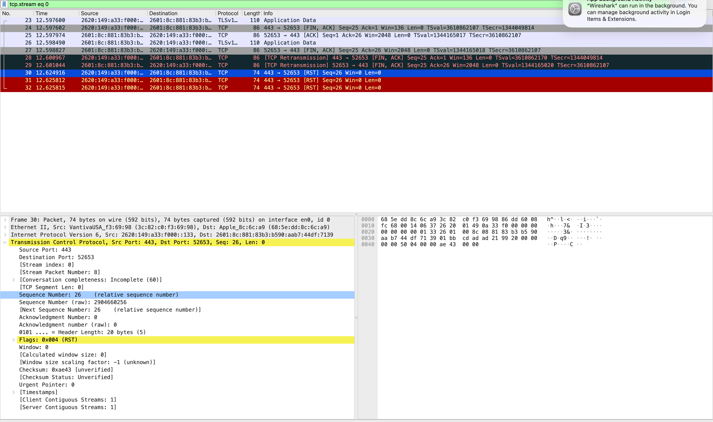
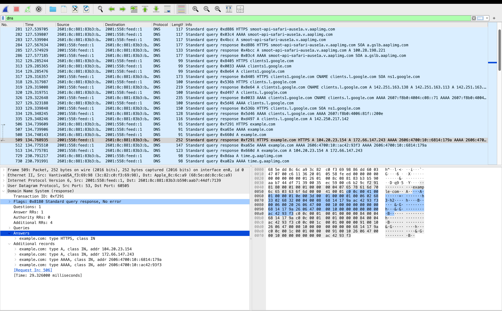

# Wireshark DNS and TCP Traffic Investigation

## Investigation Overview

**Lab:** Network Traffic Analysis  
**Tools:** Wireshark 4.6.9, macOS  
**Investigation Type:** DNS and TCP Traffic Analysis  
**Environment:** Personal SOC Homelab  
**Status:** Completed

## Objective

Capture and analyze network traffic to identify DNS queries, DNS responses, TCP retransmissions, and connection resets.

Practice interpreting network evidence from a SOC Analyst perspective.

## DNS Investigation

### Observed Activity

Generated network traffic by visiting example.com in a web browser.

Analyzed DNS queries and their corresponding responses using Wireshark.

### DNS Evidence

- Domain: example.com
- DNS query packet: 508
- DNS response packet: 513
- Record type: A (IPv4)
- Returned IP address: 104.20.23.154
- Returned IP address: 172.66.147.243
- DNS response status: No error
- Response time: Approximately 35.63 milliseconds

### DNS Findings

The DNS server successfully resolved example.com to two IPv4 addresses.

The observed activity was consistent with the authorized browser test.

No obvious malicious indicators were identified in the examined DNS response.

## TCP Investigation

### Observed Activity

Applied Wireshark display filters to investigate TCP traffic and retransmissions.

Filters used:

- dns
- tcp
- tcp.analysis.retransmission
- tcp.stream eq 0

### TCP Evidence

**Packet 28:**
- Source port: 443
- Destination port: 52653
- TCP flags: FIN, ACK
- Wireshark classification: Suspected TCP retransmission

**Packet 30:**
- Source port: 443
- Destination port: 52653
- TCP flag: RST
- TCP payload length: 0 bytes

### TCP Findings

Observed retransmission and connection reset activity within the same TCP stream.

Retransmissions may occur because of packet loss, delayed acknowledgments, or other network conditions.

A TCP reset indicates that an endpoint abruptly terminated the connection.

The available evidence was insufficient to determine the underlying cause or establish malicious activity.

## Security Assessment

**Classification:** No confirmed malicious activity

The DNS activity was consistent with the authorized test.

TCP retransmissions and resets were observed, but these events alone do not indicate a cyberattack.

Additional context would be required to determine whether the TCP behavior represented a network issue or a security incident.

## Skills Demonstrated

- Network packet capture
- DNS query and response analysis
- IPv4 address identification
- TCP flag interpretation
- TCP retransmission investigation
- TCP stream filtering
- Network traffic triage
- Evidence-based SOC investigation
- Technical documentation

## Conclusion

Successfully captured and analyzed DNS and TCP traffic using Wireshark.

Identified DNS resolution activity and investigated TCP retransmissions and connection resets.

Documented findings without classifying normal or inconclusive network behavior as malicious.

## TCP Investigation Screenshot

## DNS Investigation Screenshot

