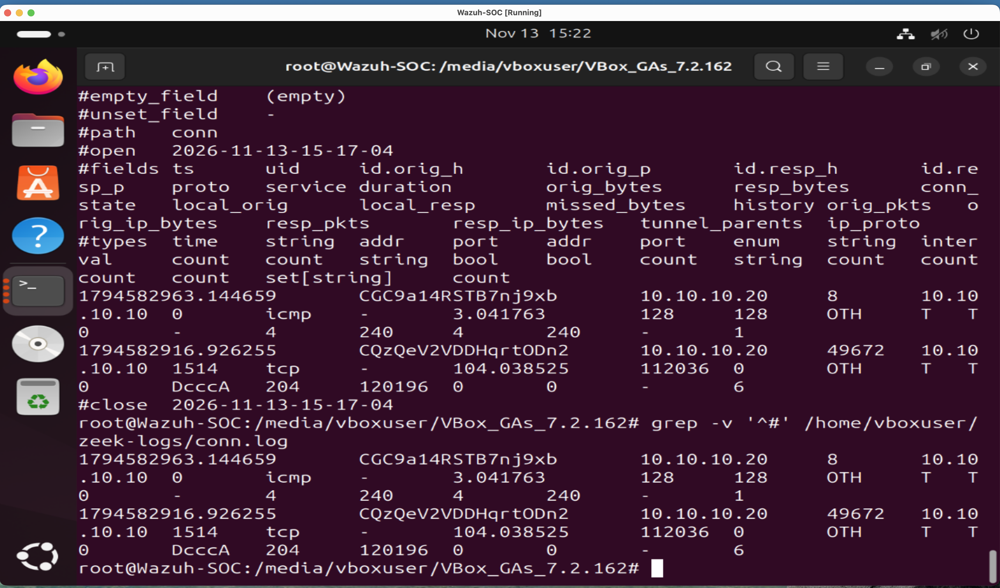

# Lab 6: Zeek Network Monitoring Investigation

## Investigation Overview

This lab demonstrates the deployment of Zeek 9.0.1 for network security monitoring in a virtual cybersecurity homelab.

The objective was to capture network traffic, analyze connection logs, and identify communication between a Windows endpoint and an Ubuntu monitoring server.

## Lab Environment

- Zeek 9.0.1
- Ubuntu 24.04 LTS (ARM64)
- Windows 11 endpoint
- Docker
- Oracle VirtualBox
- Network interface: enp0s9

## Network Configuration

- Windows endpoint: 10.10.10.20
- Ubuntu monitoring server: 10.10.10.10

## Investigation Procedure

1. Installed Docker on the Ubuntu monitoring server.
2. Downloaded the ARM64-compatible Zeek Docker image.
3. Started Zeek monitoring on the enp0s9 network interface.
4. Generated controlled ICMP traffic from the Windows endpoint.
5. Stopped the capture and reviewed the generated connection logs.
6. Identified ICMP and TCP connection records.

## Investigation Findings

Zeek successfully captured network communication between the Windows endpoint and Ubuntu monitoring server.

The connection log showed:

- Source IP: 10.10.10.20
- Destination IP: 10.10.10.10
- ICMP traffic generated using the Windows ping command
- Four ICMP packets recorded in each direction
- Additional TCP connection activity
- Zero packets dropped during capture

## Security Analysis

The ICMP traffic was generated intentionally to validate network monitoring functionality.

Zeek's conn.log provided visibility into network communication, including source and destination addresses, protocols, connection duration, and packet counts.

The observed activity was authorized lab testing and did not establish malicious behavior.

## Detection Evidence

The screenshot below shows the Zeek connection logs collected during the investigation.

## Skills Demonstrated

- Network security monitoring
- Zeek deployment using Docker
- ICMP and TCP traffic analysis
- Network log investigation
- Linux command-line administration
- Security evidence collection
- Technical investigation documentation

## Conclusion

Successfully deployed Zeek 9.0.1 in an ARM64 Ubuntu environment and analyzed network traffic generated by a Windows endpoint.

This investigation demonstrates practical network monitoring and log analysis skills relevant to an entry-level SOC Analyst role.
